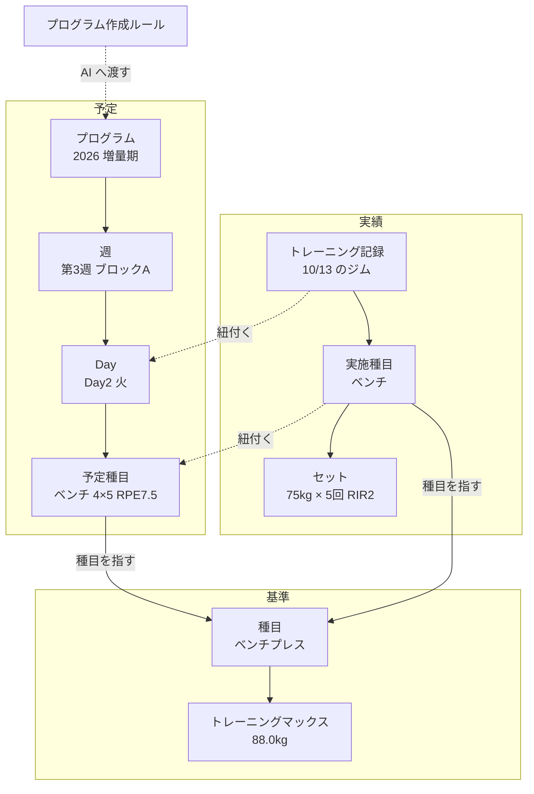
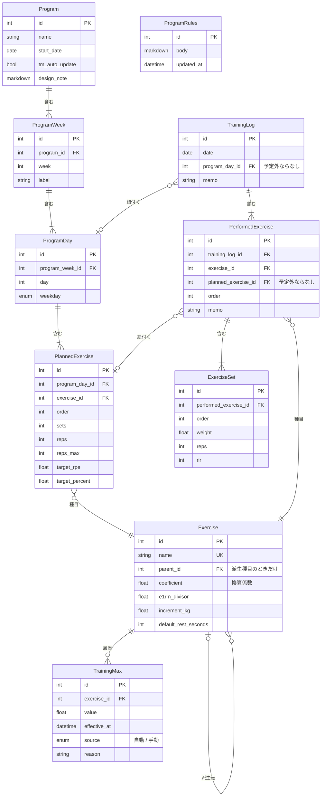

# ドメインモデル

KINNIK での記録と xlsx でのプログラム管理を1つのアプリへまとめる。この文書では、アプリが扱う概念と関係、計算規則を定義する。画面と機能は別の文書で決める。

計算式と運用ルールは `BIG3プログラム管理.xlsx` と保守プロンプトから移している。1RM の推定式は `重量 × 回数 ÷ 分母 + 重量` で、分母はベンチプレス 40、スクワットとデッドリフト 33.3。xlsx の Epley 式からは変えている。

## 全体像

アプリが持つデータは3つの層に分かれる。

| 層 | 答える問い | モデル |
|---|---|---|
| 基準 | いまの自分はどれくらい強いか | 種目、トレーニングマックス |
| 予定 | 何をやるつもりか | プログラム、週、Day、予定種目 |
| 実績 | 実際に何をやったか | トレーニング記録、実施種目、セット |

これとは別に、AI にプログラムを作らせるときのルール文としてプログラム作成ルールを1件持つ。



実線の矢印は1対多の親子関係。点線の紐付けは任意で、予定外にやった日や種目は紐付けずに記録する。

予定は4段、実績は3段の入れ子で、別々に持つ。次のプログラムへ移っても実績は残り、実績だけで分析ページを組み立てられる。

### モデル図

上の図を、モデル名と多重度と主な属性で書いたもの。



線の端の記号は多重度を表す。`||` は1、`o|` は0か1、`|{` は1以上、`o{` は0以上。たとえば `Program ||--|{ ProgramWeek` は、プログラム1つが週を1つ以上持つことを表す。

### 1日の流れ

3つの層が1つのループで回る。

1. アプリが、進行中のプログラムで次にやる Day として「第3週 Day2」を表示する
2. 予定種目「ベンチ 5回 RPE7.5」とトレーニングマックス 88.0 から、目標重量 75kg を計算する。プログラムには kg を書かず、強度の指定だけを書く
3. ジムでトレーニング記録を作り、セット「75kg × 5回 RIR2」を記録する
4. 翌週になって最初のトレーニング記録を作るとき、前の週の実績の e1RM がトレーニングマックス + 2.5 に届いたかを判定する。届いていればトレーニングマックスの履歴に1行追加する。今回の e1RM は 88.1 で、90.5 に届かないので据え置き

### 用語

| アプリでの名前 | モデル名 | xlsx での名前 | 意味 |
|---|---|---|---|
| 種目 | Exercise | 種目マスタの行、D列 | ベンチプレス、懸垂など。ユーザーが自由に追加できる |
| トレーニングマックス | TrainingMax | 設定シートの B5〜B7「設定値」と D 列の更新履歴 | 目標重量を計算する起点になる e1RM。種目ごとに履歴で持つ |
| 派生種目 | Exercise の parent があるもの | ポーズベンチ、ラーセンベンチ | 別の種目のトレーニングマックスを換算係数で借りる種目 |
| 換算係数 | Exercise.coefficient | 種目マスタの係数 | 派生種目の e1RM を参照先の種目の e1RM へ換算する係数。ポーズベンチは 0.87 |
| プログラム | Program | 減量期シート、増量期シート | 開始日と、順番に並んだ週を持つ期間。「2026 増量期」 |
| 週 | ProgramWeek | 同じ週の行のまとまり | 第3週のような1週間分の予定。「ブロックA」「デロード」のような週の位置づけを持つ |
| Day | ProgramDay | 同じ週・同じ Day の行のまとまり | 週の中の1回分のメニュー。第3週 Day2。日付ではなく順番で決まる |
| 予定種目 | PlannedExercise | プログラムのシートの1行 | Day の中の1種目。セット数・レップ数・目標RPE |
| トレーニング記録 | TrainingLog | KINNIK の1日分の記録 | ジムで実施した1回のトレーニング |
| 実施種目 | PerformedExercise | KINNIK の1日分の中の1種目 | トレーニング記録の中の1種目 |
| セット | ExerciseSet | KINNIK の1セット、J/K/L列 | 重量・回数・RIR |
| プログラム作成ルール | ProgramRules | 保守プロンプトの §1、§3、§9 | 目標、曜日、頻度の制約など、AI がプログラムを作るときに守るルール |

### 集約

集約は5つ。

| 集約ルート | 含むモデル |
|---|---|
| Exercise | |
| TrainingMax | |
| Program | ProgramWeek、ProgramDay、PlannedExercise |
| TrainingLog | PerformedExercise、ExerciseSet |
| ProgramRules | |

集約をまたぐ参照は ID で持つ。モデル図で表の同じ行に無いモデルへ向かう線がこれにあたる。Exercise への参照、TrainingLog から ProgramDay への参照、PerformedExercise から PlannedExercise への参照の3種類がある。

## 基準の層

### 種目 `Exercise`

| 属性 | 型 | 内容 |
|---|---|---|
| name | 文字列 | 一意。KINNIK の CSV の種目名との対応にも使う |
| parent_id | FK → Exercise / なし | 派生元の種目。ポーズベンチならベンチプレス。本文では parent と呼ぶ |
| coefficient | 小数 / なし | 換算係数。parent があるときだけ持つ |
| e1rm_divisor | 小数 / なし | 1RM の推定式の分母。初期値 33.3、ベンチプレス 40。parent があるときは持たず、parent の値を使う |
| increment_kg | 小数 | ダブルプログレッションで上げる幅。ダンベル 1、マシン 2.5 |
| default_rest_seconds | 整数 | レストタイマーの初期値。主種目 180、補助 90 |

種目は、重量の決め方で3種類に分かれる。種類は属性として持たず、トレーニングマックスの有無と parent から決まる。

| 種類 | 判定 | 例 | 目標重量の決め方 |
|---|---|---|---|
| トレーニングマックスを持つ種目 | トレーニングマックスの履歴がある | スクワット、ベンチプレス、デッドリフト。ショルダープレスに持たせてもよい | 自分のトレーニングマックス × RPE または % |
| 派生種目 | parent がある | ポーズベンチ、ルーマニアンDL | parent のトレーニングマックス × 換算係数 × RPE または % |
| ダブルプログレッションの種目 | どちらもない | サイドレイズ、懸垂、カール | 前回の重量と回数から決める |

- parent は1段に限る。派生種目の派生種目は作らない
- 種目は削除しない。過去の記録が参照するため

### トレーニングマックス `TrainingMax`

種目ごとの値を、変更のたびに1行追加する履歴として持つ。

| 属性 | 型 | 内容 |
|---|---|---|
| exercise_id | FK → Exercise | parent を持たない種目に限る |
| value | 小数 | 88.0 |
| effective_at | 日時 | |
| source | 自動 / 手動 | |
| reason | 文字列 | 「第3週 ベンチ 77.5kg×5回 RIR2 → e1RM 91.1 ≧ 90.5」 |

追記のみで、更新と削除はしない。現在値は種目ごとの最新の行で、設定シート D 列の更新履歴をそのまま持つ形になる。

## 予定の層

### プログラム `Program`

| 属性 | 型 | 内容 |
|---|---|---|
| name | 文字列 | 「2026 増量期」「ベンチ スモロフ Jr」 |
| start_date | 日付 | 目安日の起点 |
| tm_auto_update | 真偽 | トレーニングマックスを週ごとに自動更新するか |
| design_note | Markdown | AI が書いた設計意図。保守プロンプトの §3 にあたる。月次レビューで AI へ渡す |

**進行中のプログラムは start_date が最も新しいもの。** 新しいプログラムを追加すると、前のプログラムは終了したことになる。終了の操作は持たない。最後の Day を消化したあとは次の Day が無くなり、次のプログラムを追加するまでは予定外のトレーニング記録を作る。

**tm_auto_update はプログラムの組み方で決まる。** RPE 型のプログラムでは有効にし、% 型のプログラムでは無効にする。スモロフ Jr のように週ごとの重量の上げ方がプログラムに組み込まれている場合に、自動更新が重なると重量が二重に上がるため。AI がプログラムを生成するときに決める。

### 週 `ProgramWeek`

| 属性 | 型 | 内容 |
|---|---|---|
| program_id | FK → Program | |
| week | 整数 | 第何週か。プログラムの中で一意 |
| label | 文字列 | 「ブロックA」「デロード」「テスト」 |

プログラムの週数は ProgramWeek の数で決まる。週あたりの日数は週ごとに違ってよく、デロード週だけ3日にする形も作れる。

### Day `ProgramDay`

| 属性 | 型 | 内容 |
|---|---|---|
| program_week_id | FK → ProgramWeek | |
| day | 整数 | 週の中の何日目か。週の中で一意 |
| weekday | 曜日 | 目安の曜日。Day1=月、Day2=火、Day3=木、Day4=金 |

並び順は、週の week、Day の day の順で一意に決まる。曜日はプログラムごとに AI が決める。

### 予定種目 `PlannedExercise`

| 属性 | 型 | 内容 |
|---|---|---|
| program_day_id | FK → ProgramDay | |
| exercise_id | FK → Exercise | |
| order | 整数 | Day の中の順番 |
| sets | 整数 | |
| reps | 整数 | ダブルプログレッションの種目では回数の下限 |
| reps_max | 整数 / なし | ダブルプログレッションの種目の回数の上限。8〜12回なら 12 |
| target_rpe | 小数 / なし | トレーニングマックスを使う種目で、RPE 型のとき |
| target_percent | 小数 / なし | トレーニングマックスを使う種目で、% 型のとき。テスト週、スモロフ Jr |

- target_rpe と target_percent は、トレーニングマックスを使う種目でどちらか一方を持つ
- reps_max は、ダブルプログレッションの種目だけが持つ
- 重量は持たない。目標重量はトレーニングマックスから計算する
- 週ごとの RPE や % の上げ方は規則として持たず、AI が各予定種目に値として書く

### 生成

プログラムは AI が作る。アプリの中では AI を呼ばない。

1. アプリが生成用のプロンプトを出力する。プログラム作成ルール、種目一覧、現在のトレーニングマックス、直近の実績、進行中のプログラムの design_note、出力してほしい JSON の形を含む
2. ユーザーが「次の3週はベンチでスモロフ Jr」のような依頼を足して claude.ai に貼る
3. Claude が返した JSON をアプリに貼り戻す
4. アプリが検証し、プレビューを表示する。ユーザーが確定すると反映される

確定すると新しいプログラムとして追加され、前のプログラムは終了したことになる。前のプログラムの未消化の Day はそのまま残る。

**作成したプログラムは変更しない。** 途中で計画を変えたいときは、残りの期間を新しいプログラムとして追加する。「次の3週はベンチでスモロフ Jr」なら、3週のプログラムを追加し、終わったらまた次のプログラムを追加する。

この形にしているのは2つの理由による。

- 実績が「何を予定していたか」を参照し続ける。後から書き換えると、分析で予定と実績の比較が崩れる
- tm_auto_update がプログラム単位で決まる。RPE 型のプログラムの後半だけを % 型のスモロフ Jr に置き換えると、自動更新と % の上げ方が重なって重量が二重に上がる

**JSON の検証**: 次を満たさない JSON は反映しない。

- 種目名がすべて既存の種目と一致する。新しい種目は JSON 内の種目定義から作り、プレビューで新規と分かるように表示する
- 新しい種目の定義が increment_kg と default_rest_seconds を持つ。parent が無い種目は e1rm_divisor も持つ
- トレーニングマックスを使う種目は、target_rpe と target_percent のどちらか一方を持つ。トレーニングマックスの無い種目を RPE 型で指定していない
- week が重複しない。週の中で day が重複しない

JSON の形は次のとおり。機能設計の段階で JSON Schema に落とす。

```json
{
  "name": "2026 増量期",
  "start_date": "2026-09-28",
  "tm_auto_update": true,
  "design_note": "ブロックA→デロード→ブロックB→...",
  "new_exercises": [
    { "name": "ラーセンベンチ", "parent": "ベンチプレス", "coefficient": 0.85, "increment_kg": 2.5, "default_rest_seconds": 180 },
    { "name": "ケーブルフライ", "e1rm_divisor": 33.3, "increment_kg": 2.5, "default_rest_seconds": 90 }
  ],
  "weeks": [
    {
      "week": 1, "label": "ブロックA",
      "days": [
        {
          "day": 1, "weekday": "mon",
          "exercises": [
            { "exercise": "スクワット", "sets": 4, "reps": 5, "target_rpe": 7.5 },
            { "exercise": "ラットプルダウン", "sets": 2, "reps": 10, "reps_max": 12 }
          ]
        }
      ]
    }
  ]
}
```

## 実績の層

### トレーニング記録 `TrainingLog`

| 属性 | 型 | 内容 |
|---|---|---|
| date | 日付 | |
| program_day_id | FK → ProgramDay / なし | なしは予定外のトレーニング |
| memo | 文字列 | |

1つの Day に複数の TrainingLog を紐付けられる。1日分のメニューを2日に分けてこなす場合にあたる。

TrainingLog が持つのは、いつ・どの Day をやったかだけ。実際にやった種目は PerformedExercise に、重量と回数は ExerciseSet に持つ。

date に選べるのは今日以前の日付。未来の日付の記録があると、トレーニングマックスの評価と次の Day の決定が、まだ来ていない日の記録で進んでしまう。

### 実施種目 `PerformedExercise`

| 属性 | 型 | 内容 |
|---|---|---|
| training_log_id | FK → TrainingLog | |
| exercise_id | FK → Exercise | |
| planned_exercise_id | FK → PlannedExercise / なし | なしはプログラム外で追加した種目 |
| order | 整数 | |
| memo | 文字列 | |

### セット `ExerciseSet`

| 属性 | 型 | 内容 |
|---|---|---|
| performed_exercise_id | FK → PerformedExercise | |
| order | 整数 | セット番号。実施種目の中で一意 |
| weight | 小数 | kg。懸垂・ディップスは体重を記録する。KINNIK と同じ扱い |
| reps | 整数 | |
| rir | 整数 / なし | 空は計算で 0 として扱う |

xlsx はトップセットだけを持っていたが、アプリは KINNIK と同じく全セットを持つ。トップセットは計算で決まる。

セットは列ごとに入力し、重量と回数の両方が入った列を1セットとして保存する。重量は後ろの空の列へ自動で入るため、重量しか無い列はセットにしない。並びは入力した順ではなく order で決まる。

## プログラム作成ルール `ProgramRules`

AI にプログラムを作らせるときに渡すルール。1件だけ持ち、ユーザーが自由記述で編集する。

| 属性 | 型 | 内容 |
|---|---|---|
| body | Markdown | 目標、トレーニング曜日、頻度の制約、好きな補助種目、エビデンスの方針 |
| updated_at | 日時 | |

初期値は保守プロンプトの §1、§3、§9 から作る。「月火木金の固定」「DL 本体は週1回、SQ と DL 本体を同じ日にしない」「RPE の上限 9.0」などがここに入る。

アプリはこの本文を解釈しない。AI へ渡すだけで、守られているかは生成結果のプレビューでユーザーが確かめる。

## 計算規則

すべてセットとトレーニングマックスから導出し、値として保存しない。

### 目標重量

トレーニングマックスを使う種目は次の式で求める。TM は自分のトレーニングマックス、派生種目なら parent のトレーニングマックス。換算係数は派生種目でなければ 1。

```
RPE 型 = round_to(TM × 換算係数 / (1 + (レップ + 10 − 目標RPE) / 分母), 2.5)
% 型   = round_to(TM × 換算係数 × target_percent, 2.5)
```

RPE 型は e1RM の式の逆算で、`10 − 目標RPE` が RIR にあたる。

ダブルプログレッションの種目は、同じ種目の前回のトップセットから求める。

- 前回の全セットが reps_max に届いていれば `前回の重量 + increment_kg`
- 届いていなければ前回の重量
- 前回が無ければ目標重量を出さない

予定種目に reps_max が無いときと、プログラム外で追加した種目は、目標重量を出さない。前回実績を表示し、重量はユーザーが決める。

### e1RM

```
セットの e1RM = 重量 × (1 + (回数 + RIR) / 分母)
換算後の e1RM = round(セットの e1RM / 換算係数, 1)
```

RIR が 0 のとき `重量 × 回数 ÷ 分母 + 重量` と一致する。RIR を回数に足すのは、目標重量を RPE から逆算する式と揃えるため。外すと RIR2 で挙げたセットが過小に評価され、トレーニングマックスの自動更新に届かなくなる。

ダブルプログレッションの種目も、トップセットの選択と分析のために同じ式で e1RM を求める。

- **トップセット**: 1つのトレーニング記録の1種目の中で、セットの e1RM が最大のセット。同値なら order が小さいセット
- **前回実績**: 同じ種目を含む直近のトレーニング記録のトップセット

### 分析の指標

- 最大重量: 種目ごとのセットの重量の最大値
- 推定1RM の推移: トレーニング記録ごとのトップセットの換算後の e1RM
- 総ボリューム: 重量 × 回数 の合計。種目別・週別・月別に集計する

## ドメインルール

### 次の Day は順番で決める

進行中のプログラムで、トレーニング記録が紐付いた Day のうち週の week、Day の day の順で最も遅いものの、1つ後ろの Day を「次の Day」とする。記録が1件も無ければ最初の Day。

スキップの操作は持たない。次の Day より前にあって記録の無い Day は未実施として扱う。トレーニング記録を作るときに Day を選び直せるため、Day を飛ばしたいときは後ろの Day を選んで記録すれば足りる。

目安日は `start_date + (week − 1) × 7 + weekday のオフセット` で求めるが、表示に限る。運用ルールが「Day の順番を守り、遅れたら全体を後ろへずらす」ためで、日付で決めると遅れた週のメニューが飛ばされる。

### トレーニングマックスは週ごとに自動更新する

評価の単位は月曜始まりのカレンダーの週。プログラムの週とは対応させない。予定の Day を全部消化していなくても評価する。

**評価のタイミング**: トレーニング記録を作るとき、その date が既存の記録の最も新しい date より後の週に入るなら、最も新しい date が属する週を評価する。週は記録を作った時刻ではなく date で決める。目標重量が必要になるのはトレーニングを始めるときなので、その時点で更新されていれば足りる。トレーニングの終了操作は持たない。

評価済みの週に後から記録を追加しても、その週は評価し直さない。追加した記録で更新に届いていたら、手動の変更で直す。

**対象**: 評価する週に進行中だったプログラムの tm_auto_update が有効なときに限る。

**更新の条件**: トレーニングマックスを持つ種目ごとに、評価する週のセットの換算後の e1RM の最大値が `現在の TM + 2.5` 以上なら、`TM + 2.5` の行を source = 自動で追加する。派生種目のセットは parent の評価に加わる。

- 1回の評価で上げるのは 2.5kg まで
- 下回っても下げない。下げるのは手動の変更に限る
- 判定に使うのは評価する週のセットに限る。過去の1回の記録だけで、毎週上がり続けることはない

### 予定外の記録

- Day に紐付いたトレーニング記録に、プログラム外の種目を追加できる
- Day に紐付かないトレーニング記録も作れる。xlsx の「実績のみ」行にあたる
- 予定外の記録もトップセット、前回実績、トレーニングマックスの評価の計算に加える

## 移行

アプリへの切り替え時に1回だけ実行する。KINNIK での記録はアプリへ置き換わるため、継続的な取り込みは持たない。

1. **種目**: xlsx の種目マスタと、KINNIK の CSV に現れる種目名から作る。名前の対応は保守プロンプトの表に従う。ルーマニアンデッドリフトはルーマニアンDL、ポーズベンチプレスはポーズベンチ。種目マスタで区分が SQ / BP / DL の種目は、係数 1 なら parent なし、それ以外は本体を parent にする
2. **トレーニングマックス**: 直近の実績から新しい式で求めた値を、ユーザーが手動で1件入力する。xlsx の更新履歴は Epley 式の値のため取り込まない
3. **プログラム作成ルール**: 保守プロンプトの §1、§3、§9 から作る
4. **増量期のプログラム**: 増量期シートの278行を週、Day、予定種目へ変換する。週の label は、その週の行のラベルから取る。tm_auto_update は有効、design_note は保守プロンプトの §3。減量期は終了済みのため、予定は取り込まない
5. **トレーニング記録**: KINNIK の CSV の全セットを取り込む。xlsx の実績の行が持つ実際の日付と Day を使って、同じ日付のトレーニング記録をその Day へ紐付ける。xlsx に無い日付のものは予定外のトレーニング記録にする。xlsx で「未実施」の Day は、後ろの Day に記録があるため未実施として扱われる

KINNIK の CSV に RIR は無い。取り込んだセットの RIR は空になり、e1RM は低めに出る。xlsx の L 列に RIR があるトップセットは、その値で補う。

増量期の補助種目は xlsx で回数が固定値になっている。移行時は reps_max を持たせず、目標重量は出さずに前回実績を表示する。次のプログラムの生成から回数の幅を持たせる。

## 通知

レストタイマーは PWA と Web Push で作る。開始ボタンを押した時刻に `default_rest_seconds` を足した時刻に、サーバーから通知を送る。停止ボタンを押すと送信予約を取り消す。画面をロックしていても iPhone で通知音が鳴る。

Web Push の購読情報と送信予約はインフラの関心事で、ドメインモデルには含めない。

## モデルに入れないもの

| 対象 | 理由 | 追加する時期 |
|---|---|---|
| 体重記録 | 増量期は体重を管理しない方針 | 次の減量期の前 |
| 停滞判定とデロード前倒しの閾値 | 月次レビューで AI が判断する | 判断を自動化したくなったとき |
| アプリ内の AI 呼び出し | claude.ai への貼り付けで運用する | 貼り付けの手間が気になったとき。JSON の形は共通にできる |
| 複数ユーザー | 自分用 | |
